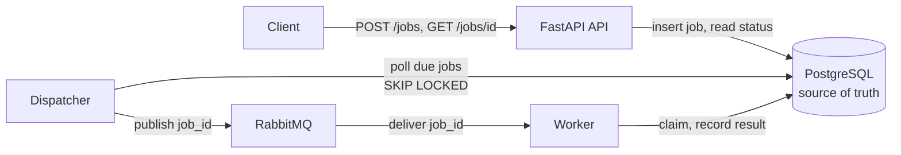

# distributed-task-platform

A background-job system built to make failure behaviour explicit: an HTTP API saves jobs in
PostgreSQL, a dispatcher publishes them to RabbitMQ, and separate workers run them with bounded
retries, so slow work stays out of the request path and every failure is recorded.

> **Status: early development (phase 3 of 10).** So far there are the domain rules, a local
> PostgreSQL with the `jobs` table migration, `POST /jobs` (validates and saves a job; 503 when
> the database is unavailable), `GET /jobs/{id}` (a job's state, never its payload), the `/health`
> and `/ready` probes, a local RabbitMQ with the connection and queue code (no dispatcher or worker
> yet), and the development checks (see Development setup). The architecture, MVP scope and
> roadmap describe the planned design; Known limitations covers both the planned design and the
> code that exists.

## Planned architecture



- The API only writes to PostgreSQL. A `202` response means the job is **saved**, not that it was
  published ([ADR 0002](docs/adr/0002-dual-write-strategy.md)).
- Messages carry only the job ID. Workers read the job from PostgreSQL.
- Delivery is at-least-once. Workers claim a job with an atomic conditional update, so a duplicate
  message cannot claim a job that is already claimed. Each claim holds a lease; jobs of crashed
  workers are recovered when the lease expires, and a stale worker's late result is rejected
  ([ADR 0001](docs/adr/0001-job-lifecycle.md)).

## MVP scope

- Submit a job of one type, `notification.send`, over HTTP. Its payload is typed, versioned and
  size-limited. The notification goes to a **fake provider** that records it in the database instead
  of sending anything, so duplicate side effects are observable in tests.
- Save the job durably and return its ID.
- Dispatch it through RabbitMQ and run it in a separate worker process.
- Retry failures with bounded attempts and exponential backoff with jitter.
- Move jobs that exhaust their attempts to `failed`, with a dead-letter path for inspection.
- Read a job's status, attempts, safe error and result over HTTP.
- Recover from worker crashes, broker outages and stuck jobs, with tests for each failure path.

## Non-goals (MVP)

- Authentication and multiple tenants (see Known limitations).
- Job cancellation, priorities, cron or scheduled jobs, and workflows or job chains.
- More than one task type.
- Large results. Results are small JSON values stored with the job.
- A UI or dashboard.
- A second broker or queue technology.
- Performance claims. Nothing has been benchmarked.

## Roadmap

The ADRs refer to these phases by number.

1. Job contracts, statuses and architecture decisions *(done)*
2. HTTP API and durable job records *(in progress)*
3. Dispatcher, RabbitMQ and the first worker
4. Status and result endpoints
5. Retries with exponential backoff and jitter
6. Dead letters and failure inspection
7. Idempotency for submission and side effects
8. Graceful shutdown, stale-job and lost-message recovery, broker outages
9. Failure-path test suite
10. Documentation of delivery guarantees and operations

## Architecture decisions

| ADR | Decision |
|-----|----------|
| [0001](docs/adr/0001-job-lifecycle.md) | Four job statuses; attempts counted when a worker claims a job |
| [0002](docs/adr/0002-dual-write-strategy.md) | The jobs table is the outbox; a dispatcher publishes due jobs |
| [0003](docs/adr/0003-async-io-stack.md) | asyncio throughout: SQLAlchemy asyncio, asyncpg, aio-pika |
| [0004](docs/adr/0004-dispatch-and-consumption.md) | One quorum queue; the worker acks, nacks or rejects per outcome |

## Health and readiness probes

- `GET /health` is liveness: it returns `200 {"status": "ok"}` whenever the process answers and
  touches no dependency, so a liveness check on it never restarts the API because of a database
  outage.
- `GET /ready` returns `200 {"status": "ready"}` when PostgreSQL answers and its migration revision
  is exactly the one this code expects. Otherwise it returns `503 service_unavailable` with
  `details` naming the failed check, `["database"]` or `["migrations"]`, never an error text or a
  revision id. The whole check is bounded by `READY_CHECK_TIMEOUT_S`.
- `/ready` does **not** check RabbitMQ. The API never talks to the broker: it only saves jobs, and
  a dispatcher publishes them (ADR 0002). An instance that can save jobs must keep accepting them
  during a broker outage.
- `/ready` takes its connection from the API's own pool, so it reports whether a request could get
  a connection right now, not only whether PostgreSQL is up. A full pool therefore fails `/ready`
  with `["database"]` even when PostgreSQL is fine, which takes a busy instance out of rotation.

## Known limitations

- **No authentication.** Anyone who can reach the API can submit jobs, which means triggering
  notifications, and anyone who knows a job ID can read that job's status. Run it only on a trusted
  network. The same goes for `/ready`: it tells anyone who can reach it whether the database is
  at this code's migration revision.
- A worker crash uses up one of the job's attempts, even when the crash had nothing to do with the
  job (ADR 0001).
- Dispatch latency is up to one dispatcher poll interval (ADR 0002).
- A worker whose lease expired may still finish its handler. Its result is rejected, but its side
  effect can happen twice, so handlers with side effects must be idempotent (ADR 0001).
- Recovering a crashed worker's job takes up to the lease duration plus the recovery interval.
- **A submission whose COMMIT outcome is unknown can be saved twice.** If the connection drops or
  `DB_COMMAND_TIMEOUT_S` expires while PostgreSQL commits, the client gets 503 although the job
  may have been saved; a retry then creates a second job. Idempotency keys (phase 7) close this.
- Database and connection errors are logged as their class, SQLSTATE and constraint name only,
  without a traceback, because PostgreSQL's error detail can quote the stored payload. Any
  `OSError` is treated as "database unavailable" (503). Other unexpected errors return 500 and
  uvicorn logs their full traceback for debugging, so a bug whose traceback holds request data
  could still write it to the log.
- uvicorn's access log records each request's raw path and query string, so job IDs, whatever a
  client sent in place of one and anything after a `?` end up in the log. Payloads never do: they
  travel only in request bodies.
- `/ready` requires the database revision to equal the code's exactly. During a rolling deploy,
  instances running the old code report not ready as soon as the new migration is applied. The MVP
  runs one instance and migrates before starting it.
- Each failing `/ready` call logs one warning, so frequent probing during an outage produces many
  identical lines. The database line includes pool usage (e.g. `pool 5/5 in use`), but under
  traffic a slow database also fills the pool, so a full pool alone does not show the database is
  healthy.
- All limits and timeouts are placeholders, not measured values; `.env.example` lists every one
  with its default (e.g. payload 64 KiB, statement timeout 5 s, client command timeout 10 s).

## Development setup

Requires [uv](https://docs.astral.sh/uv/), GNU Make and Docker with Compose. uv installs the pinned
Python (3.12, see `.python-version`) if it is missing.

```bash
make install                  # create .venv and install locked dependencies
uv run pre-commit install     # run lint, format, mypy and secret checks on every commit
cp .env.example .env          # then replace every change-me with a local password
make up                       # start PostgreSQL (127.0.0.1:5432) and RabbitMQ (127.0.0.1:5672)
make db-migrate               # apply migrations to the development database
make run                      # start the API on 127.0.0.1:8000 (docs at /docs)
make check                    # lint, format check, mypy --strict, unit tests
make test-integration         # tests against task_platform_test and the local RabbitMQ
make check-all                # both of the above
make format                   # apply ruff formatting and safe lint fixes
make down                     # stop both; the data volumes are kept
```

- The passwords in `.env` are applied only when each container's volume is first created, and
  the `task_platform_test` database is created at the same moment. Changing them later requires
  recreating the volumes (`docker compose down -v`, which deletes all local data).
- `make up` waits until both healthchecks pass: PostgreSQL accepts connections and RabbitMQ's
  AMQP listener is up.
- Integration tests fail, rather than skip, when `TEST_DATABASE_URL` or `TEST_BROKER_URL` is
  missing, and refuse any database whose name does not end in `_test`. Broker tests declare
  queues with unique names and delete only those, so they can share the local RabbitMQ.
- Migrations are written by hand, never autogenerated:
  `make db-revision id=0002 m="what it does"` creates an empty revision to fill in.

CI runs `make check` and the integration tests against PostgreSQL and RabbitMQ service containers
on Python 3.12 and 3.14, and scans the full git history for secrets with gitleaks.
