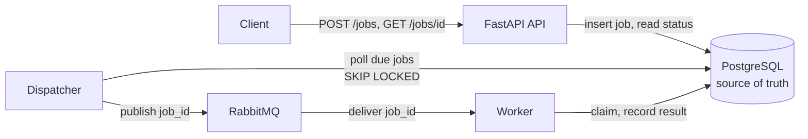

# distributed-task-platform

A background-job system built to make failure behaviour explicit: an HTTP API saves jobs in
PostgreSQL, a dispatcher publishes them to RabbitMQ, and separate workers run them with bounded
retries, so slow work stays out of the request path and every failure is recorded.

> **Status: early development (phase 2 of 10).** So far there are the domain rules, a local
> PostgreSQL with the `jobs` table migration, and the development checks (see Development setup).
> Everything else below, including scope and limitations, describes the planned design, not
> working code.

## Planned architecture



- The API only writes to PostgreSQL. A `202` response means the job is **saved**, not that it was
  published ([ADR 0002](docs/adr/0002-dual-write-strategy.md)).
- Messages carry only the job ID. Workers read the job from PostgreSQL.
- Delivery is at-least-once. Workers claim a job with an atomic conditional update, so a duplicate
  message cannot claim a job that is already claimed. Each claim holds a lease; jobs of crashed
  workers are recovered when the lease expires, and a stale worker's late result is rejected
  ([ADR 0001](docs/adr/0001-job-lifecycle.md)).

## MVP scope

- Submit a job of one type, `notification.send`, over HTTP. Its payload is typed, versioned and
  size-limited. The notification goes to a **fake provider** that records it in the database instead
  of sending anything, so duplicate side effects are observable in tests.
- Save the job durably and return its ID.
- Dispatch it through RabbitMQ and run it in a separate worker process.
- Retry failures with bounded attempts and exponential backoff with jitter.
- Move jobs that exhaust their attempts to `failed`, with a dead-letter path for inspection.
- Read a job's status, attempts, safe error and result over HTTP.
- Recover from worker crashes, broker outages and stuck jobs, with tests for each failure path.

## Non-goals (MVP)

- Authentication and multiple tenants (see Known limitations).
- Job cancellation, priorities, cron or scheduled jobs, and workflows or job chains.
- More than one task type.
- Large results. Results are small JSON values stored with the job.
- A UI or dashboard.
- A second broker or queue technology.
- Performance claims. Nothing has been benchmarked.

## Roadmap

The ADRs refer to these phases by number.

1. Job contracts, statuses and architecture decisions *(in progress)*
2. HTTP API and durable job records
3. Dispatcher, RabbitMQ and the first worker
4. Status and result endpoints
5. Retries with exponential backoff and jitter
6. Dead letters and failure inspection
7. Idempotency for submission and side effects
8. Graceful shutdown, stale-job and lost-message recovery, broker outages
9. Failure-path test suite
10. Documentation of delivery guarantees and operations

## Architecture decisions

| ADR | Decision |
|-----|----------|
| [0001](docs/adr/0001-job-lifecycle.md) | Four job statuses; attempts counted when a worker claims a job |
| [0002](docs/adr/0002-dual-write-strategy.md) | The jobs table is the outbox; a dispatcher publishes due jobs |
| [0003](docs/adr/0003-async-io-stack.md) | asyncio throughout: SQLAlchemy asyncio, asyncpg, aio-pika |

## Known limitations

- **No authentication.** Anyone who can reach the API can submit jobs, which means triggering
  notifications, and anyone who knows a job ID can read that job's status. Run it only on a trusted
  network.
- A worker crash uses up one of the job's attempts, even when the crash had nothing to do with the
  job (ADR 0001).
- Dispatch latency is up to one dispatcher poll interval (ADR 0002).
- A worker whose lease expired may still finish its handler. Its result is rejected, but its side
  effect can happen twice, so handlers with side effects must be idempotent (ADR 0001).
- Recovering a crashed worker's job takes up to the lease duration plus the recovery interval.

## Development setup

Requires [uv](https://docs.astral.sh/uv/), GNU Make and Docker with Compose. uv installs the pinned
Python (3.12, see `.python-version`) if it is missing.

```bash
make install                  # create .venv and install locked dependencies
uv run pre-commit install     # run lint, format, mypy and secret checks on every commit
cp .env.example .env          # then replace every change-me with a local password
make db-up                    # start PostgreSQL on 127.0.0.1:5432 and wait until it is healthy
make db-migrate               # apply migrations to the development database
make check                    # lint, format check, mypy --strict, unit tests
make test-integration         # tests against the task_platform_test database
make check-all                # both of the above
make format                   # apply ruff formatting and safe lint fixes
make db-down                  # stop PostgreSQL; the data volume is kept
```

- The password in `.env` is applied only when the PostgreSQL volume is first created, and the
  `task_platform_test` database is created at the same moment. Changing either later requires
  recreating the volume (`docker compose down -v`, which deletes all local data).
- Integration tests fail, rather than skip, when `TEST_DATABASE_URL` is missing, and refuse any
  database whose name does not end in `_test`.
- Migrations are written by hand, never autogenerated:
  `make db-revision id=0002 m="what it does"` creates an empty revision to fill in.

CI runs `make check` and the integration tests against a PostgreSQL service container on Python
3.12 and 3.14, and scans the full git history for secrets with gitleaks.
