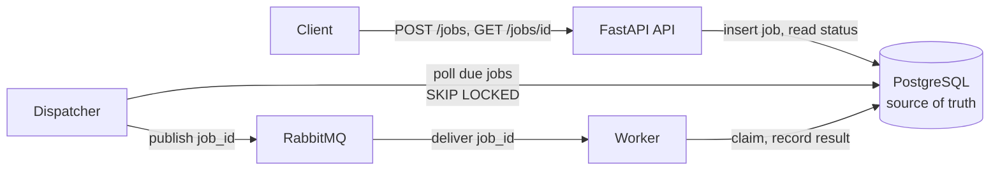

# distributed-task-platform

A background-job system built to make failure behaviour explicit: an HTTP API saves jobs in
PostgreSQL, a dispatcher publishes them to RabbitMQ, and separate workers run them with bounded
retries, so slow work stays out of the request path and every failure is recorded.

> **Status: early development (phase 8 of 10).** So far there are the domain rules, a local
> PostgreSQL with migrations for the `jobs` table (including the lease, error and result columns
> the worker writes), the `job_attempts` table and the fake provider's `fake_notifications` table,
> `POST /jobs` (validates and saves a job, safe to retry with an `Idempotency-Key`; 503 when the
> database is unavailable), `GET /jobs/{id}`
> (a job's state, result or failure, never its payload), `GET /jobs/{id}/attempts` (each recorded
> attempt and how it ended), `GET /jobs?status=failed` (failed jobs, newest first), the `/health`
> and `/ready` probes, a local RabbitMQ with the connection, queue, dead-letter queue and
> confirmed-publish code, the dispatcher process that publishes saved jobs
> to it, the worker process that claims each job, runs it against a fake notification provider
> (one notification per job, however often its handler runs), records the result and retries the
> handler's own failures with backoff, recovery of crashed workers' jobs and of lost messages,
> graceful shutdown, waiting out outages at start and while running, and the development checks
> (see Development setup).
> Architecture says which parts of the design run today; MVP scope and the roadmap describe the
> planned design; Known limitations covers both.

## Architecture



The diagram and the bullets describe the design; the last bullet says what runs today.

- The API only writes to PostgreSQL. A `202` response means the job is **saved**, not that it was
  published ([ADR 0002](docs/adr/0002-dual-write-strategy.md)).
- Messages carry only the job ID. Workers read the job from PostgreSQL.
- Delivery is at-least-once. Workers claim a job with an atomic conditional update, so a duplicate
  message cannot claim a job that is already claimed. Each claim holds a lease; jobs of crashed
  workers are recovered when the lease expires, and a stale worker's late result is rejected
  ([ADR 0001](docs/adr/0001-job-lifecycle.md)).
- **Running today (phase 8):** the API, the dispatcher and the worker run as separate processes
  (`make run`, `make dispatcher`, `make worker`), with the claim, the lease column, the fenced
  final update, retries with exponential backoff and jitter, a row per attempt, a dead-letter
  queue for messages the worker can never process, a list of failed jobs, idempotency keys for
  submissions, and one notification per job however often its handler runs. Integration tests
  take a job from `POST /jobs` through the dispatcher and a worker to `succeeded`, once at the
  first attempt, once after two failed attempts, and once after three attempts that each reached
  the provider (one notification), and a job that always fails to `failed` after its last attempt,
  where the failed-jobs list shows it. The dispatcher also recovers jobs whose worker crashed and
  jobs whose message was lost; both processes stop gracefully on a signal, wait for the database
  and the broker at start, and survive broker outages (see [docs/operations.md](docs/operations.md)).

## MVP scope

- Submit a job of one type, `notification.send`, over HTTP. Its payload is typed, versioned and
  size-limited. The notification goes to a **fake provider** that records it in the database instead
  of sending anything, so tests can see each notification and which attempt sent it.
- Save the job durably and return its ID.
- Dispatch it through RabbitMQ and run it in a separate worker process.
- Retry failures with bounded attempts and exponential backoff with jitter.
- Move jobs that exhaust their attempts to `failed`, with a dead-letter path for inspection.
- Read a job's status, attempts, safe error and result over HTTP.
- Recover from worker crashes, broker outages and stuck jobs, with tests for each failure path.

## Non-goals (MVP)

- Authentication and multiple tenants (see Known limitations).
- Job cancellation, priorities, cron or scheduled jobs, and workflows or job chains.
- More than one task type.
- Large results. Results are small JSON values stored with the job.
- A UI or dashboard.
- A second broker or queue technology.
- Performance claims. Nothing has been benchmarked.

## Roadmap

The ADRs refer to these phases by number.

1. Job contracts, statuses and architecture decisions *(done)*
2. HTTP API and durable job records *(done)*
3. Dispatcher, RabbitMQ and the first worker *(done)*
4. Status and result endpoints *(done)*
5. Retries with exponential backoff and jitter *(done)*
6. Dead letters and failure inspection *(done)*
7. Idempotency for submission and side effects *(done)*
8. Graceful shutdown, stale-job and lost-message recovery, broker outages *(done)*
9. Failure-path test suite *(done)*
10. Documentation of delivery guarantees and operations

## Architecture decisions

| ADR | Decision |
|-----|----------|
| [0001](docs/adr/0001-job-lifecycle.md) | Four job statuses; attempts counted when a worker claims a job |
| [0002](docs/adr/0002-dual-write-strategy.md) | The jobs table is the outbox; a dispatcher publishes due jobs |
| [0003](docs/adr/0003-async-io-stack.md) | asyncio throughout: SQLAlchemy asyncio, asyncpg, aio-pika |
| [0004](docs/adr/0004-dispatch-and-consumption.md) | One quorum queue; the worker acks, nacks or rejects per outcome |
| [0005](docs/adr/0005-retries-and-attempt-records.md) | Only handler failures are retried, with full-jitter backoff; a row per attempt |
| [0006](docs/adr/0006-dead-letters.md) | Messages the worker can never process go to a dead-letter queue; failed jobs stay rows |
| [0007](docs/adr/0007-idempotency.md) | Submissions deduplicated by an `Idempotency-Key` in PostgreSQL; side effects by the receiver, with a key per job |
| [0008](docs/adr/0008-recovery-and-shutdown.md) | The dispatcher recovers expired leases and lost messages; graceful stop on a signal; outages waited out |

## Submitting a job

`POST /jobs` takes `{"type", "payload_version", "payload"}` and answers `202 {"id", "status"}`
with a `Location` header once the job is saved (not yet dispatched).

To retry a submission safely, send an `Idempotency-Key` header and retry with the same key and the
same body (ADR 0007):

```http
POST /jobs
Idempotency-Key: 8e03978e-40d5-43e8-bc93-6894a57f9324
Content-Type: application/json

{"type": "notification.send", "payload_version": 1,
 "payload": {"recipient": "max@example.com", "subject": "Hi", "body": "Hello"}}
```

| The key | Answer |
|---------|--------|
| Not sent, or not used before | `202` and a new job, as above |
| Used before, with the same `type`, `payload_version` and `payload` | `200` with that job's ID and *current* status, and its `Location`; nothing new is saved |
| Used before, with anything else | `422 idempotency_key_reused`; nothing is saved |

- A key is 1–255 visible ASCII characters (no spaces), compared exactly; `"abc"` with quotes
  and `abc` are different keys. Anything else, or the header sent twice, is `422 invalid_request`.
- Use a random value such as a UUIDv4, a new one per job. A key must not carry secrets: it is
  stored as sent (never returned or logged).
- **Keys never expire.** A key names its job for as long as the job exists, and jobs are never
  deleted.
- "The same body" means the same parsed JSON: whitespace and the order of object keys do not
  matter; any other difference counts.
- The key is checked before the body, and the body before the database, so a refused request does
  not use its key: fix the body and send it again with the same key.
- Two requests with one key at the same time do not both save a job: the second waits for the
  first one's COMMIT, then gets the `200`. If that wait outlasts `DB_STATEMENT_TIMEOUT_MS`, it
  gets `503`, and its next retry finds the job. If the first request fails instead, the waiting
  one saves its own job.

## Reading a job

`GET /jobs/{id}` returns a job's state from PostgreSQL: `status`, `attempts`, `max_attempts`, the
timestamps, and two fields that depend on the status. It never returns the payload.

| `status` | `result` | `failure` |
|----------|----------|-----------|
| `queued`, `running` | `null` | `null` |
| `succeeded` | what the handler returned, e.g. `{"provider": "fake", "notification_id": "…"}` | `null` |
| `failed` | `null` | `{"code": "handler_timeout", "message": "the job's handler did not finish in time"}` |

`failure.code` is one of a fixed set of categories and `failure.message` a fixed sentence per code,
never exception text, which can quote the payload. The key is `failure`, not `error`, so a failed
job's `200` body cannot be mistaken for the API's error envelope. A handler's result is shown to
clients, so a handler must never copy its payload into it.

A job that is waiting for a retry is `queued` with `attempts > 0` and shows `failure: null`: its
earlier failures are in its attempts.

## Retries and attempts

When a handler raises (`handler_error`) or exceeds `HANDLER_TIMEOUT_S` (`handler_timeout`), the
worker puts the job back to `queued`, due after a backoff, and acks the message; the dispatcher
publishes it again once it is due. After attempt `n` fails, the backoff is a random share of
`min(RETRY_MAX_DELAY_S, RETRY_BASE_DELAY_S × 2^(n−1))` (full jitter). The job fails when its last
attempt (`max_attempts`, set at submission from `DEFAULT_MAX_ATTEMPTS`) fails. A stored payload
that no longer passes validation fails the job at once: it would fail the same way every time
([ADR 0005](docs/adr/0005-retries-and-attempt-records.md)).

`GET /jobs/{id}/attempts` lists the job's recorded attempts, lowest first, never its payload:

```json
{"attempts": [
  {"attempt": 1, "started_at": "…", "finished_at": "…", "outcome": "failed",
   "failure": {"code": "handler_error", "message": "the job's handler raised an error"}},
  {"attempt": 2, "started_at": "…", "finished_at": null, "outcome": null, "failure": null}
]}
```

`outcome` is `succeeded`, `failed`, or `null` while the attempt runs. The list is empty until the
job is first claimed, and for a job that ran before migration 0003; an unknown job gets `404
job_not_found`. The list need not start at attempt 1: see [docs/limitations.md](docs/limitations.md).

## Listing failed jobs

`GET /jobs?status=failed` lists failed jobs, newest first, each exactly as `GET /jobs/{id}` shows
it, never with its payload. `status` is required and only `failed` is accepted so far.

```json
{"jobs": [{"id": "…", "status": "failed", "attempts": 3, "max_attempts": 3, "…": "…",
           "failure": {"code": "handler_error", "message": "the job's handler raised an error"}}],
 "next_cursor": "MjAyNi0xMS0wN1QyMzo1OTowMS4xMjM0NTYrMDA6MDBf…"}
```

A page holds `limit` jobs (1–100, default 50; placeholders, not measured). Pass `next_cursor` back
as `cursor` for the next page; it is `null` on the last one. The cursor is opaque. Pages are cut by
the time a job failed and then its ID, and a failed job never changes again, so walking the pages
lists every failed job that existed when the walk began exactly once, even while new jobs fail. A
cursor the API did not make gets `422 invalid_request`. Migration 0004 adds the index the list
reads.

## Operations

Running several workers, configuration, migrations, failed jobs and the dead-letter queue,
recovery, stopping, outages, logs and the health and readiness probes are in
[docs/operations.md](docs/operations.md).

## Known limitations

The most important ones; all of them, grouped by theme, are in
[docs/limitations.md](docs/limitations.md).

- **No authentication.** Anyone who can reach the API can submit jobs and read any job whose ID
  they know, and `GET /jobs?status=failed` lists the failed ones. Run it only on a trusted
  network.
- **A handler can run more than once for one job** (at-least-once delivery). Only
  `notification.send` is safe to repeat, because the fake provider keeps one notification per key
  `notification.send:{job_id}`; a real provider would have to keep keys long enough.
- **A worker crash uses up one of the job's attempts**, even when the job was not at fault.
- **A submission without an `Idempotency-Key` can be saved twice** if the connection drops or
  `DB_COMMAND_TIMEOUT_S` expires while PostgreSQL commits, or the client never receives its `202`.
- **Some jobs never end.** A job whose claim the database rejects for its own data, or whose
  message is dead-lettered before every claim, is published again every `LOST_MESSAGE_AFTER_S`.
- **Nothing is measured.** All limits and timeouts are placeholders, and nothing has been
  benchmarked.

## Development setup

Requires [uv](https://docs.astral.sh/uv/), GNU Make and Docker with Compose. uv installs the pinned
Python (3.12, see `.python-version`) if it is missing.

```bash
make install                  # create .venv and install locked dependencies
uv run pre-commit install     # run lint, format, mypy and secret checks on every commit
cp .env.example .env          # then replace every change-me with a local password
make up                       # start PostgreSQL (127.0.0.1:5432) and RabbitMQ (127.0.0.1:5672)
make db-migrate               # apply migrations to the development database
make run                      # start the API on 127.0.0.1:8000 (docs at /docs)
make dispatcher               # publish saved jobs to RabbitMQ until Ctrl-C
make worker                   # run published jobs, one at a time, until Ctrl-C
make check                    # lint, format check, mypy --strict, unit tests
make test-integration         # tests against task_platform_test and the local RabbitMQ
make check-all                # both of the above
make format                   # apply ruff formatting and safe lint fixes
make down                     # stop both; the data volumes are kept
```

- The passwords in `.env` are applied only when each container's volume is first created, and
  the `task_platform_test` database is created at the same moment. Changing them later requires
  recreating the volumes (`docker compose down -v`, which deletes all local data).
- `make up` waits until both healthchecks pass: PostgreSQL accepts connections and RabbitMQ's
  AMQP listener is up.
- Integration tests fail, rather than skip, when `TEST_DATABASE_URL` or `TEST_BROKER_URL` is
  missing, and refuse any database whose name does not end in `_test`. Broker tests declare
  queues with unique names and delete only those and their `.dead` queues, so they can share the
  local RabbitMQ.
- The dispatcher and the worker exit with status 1 at start if the development database is not
  at this code's migration revision (run `make db-migrate`). Ctrl-C stops them gracefully; a
  second Ctrl-C stops them within a few seconds. Several workers can run at once. How they start,
  stop, recover and log: [docs/operations.md](docs/operations.md).
- Migrations are written by hand, never autogenerated:
  `make db-revision id=0002 m="what it does"` creates an empty revision to fill in.

CI runs `make check` and the integration tests against PostgreSQL and RabbitMQ service containers
on Python 3.12 and 3.14, and scans the full git history for secrets with gitleaks.
